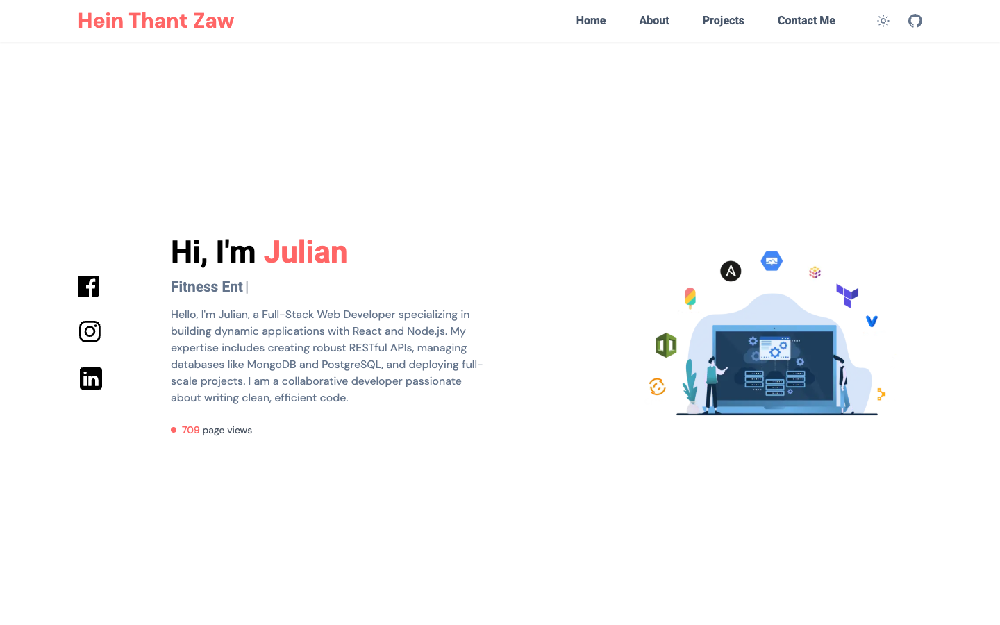

# Personal portfolio

My personal site, built with Next.js 15 and React 19. It covers my education, work experience and projects, and keeps a page-view counter in Vercel Blob.

**Live site:** https://www.julianzaw.me



## Status

Live and maintained.

## What it does

- Opens with an intro that cycles through roles with a typewriter effect.
- Shows education and work experience as vertical timelines.
- Lists projects on a timeline with tags and links.
- Pulls coding-practice stats from the LeetCode and Codewars APIs.
- Counts page views through `/api/page-views`, which stores the count in Vercel Blob.
- Switches between light and dark themes with `next-themes`.

## Tech stack

- Next.js 15 (App Router), React 19 and TypeScript
- Tailwind CSS
- Vercel Blob for the page-view count
- Vercel for hosting

## Run it locally

You need Node.js 18 or later. The page-view counter also needs a Vercel Blob store.

1. Install the dependencies:

   ```bash
   npm install
   ```

2. To turn on the page-view counter, create `.env.local` with your Blob token:

   ```bash
   BLOB_READ_WRITE_TOKEN=
   ```

3. Start the dev server and open http://localhost:3000:

   ```bash
   npm run dev
   ```

## Edit the content

The page content lives in data files, so updating the site rarely touches components:

| File | Content |
| --- | --- |
| `src/data/EducationElements.tsx` | Education timeline |
| `src/data/WorkExperienceElements.tsx` | Work experience timeline |
| `src/data/TimelineElements.tsx` | Projects timeline |
